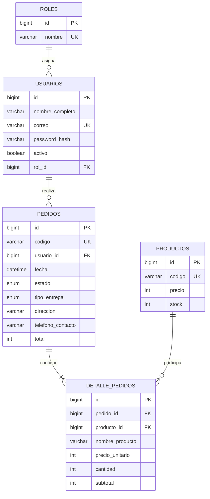

# Diagrama ER - Pedidos, usuarios y roles

`03_usuarios.sql` crea las tablas `roles` y `usuarios`, e incorpora la clave foránea entre `pedidos.usuario_id` y `usuarios.id`.

**Pendiente de coordinación:** la clave foránea mantiene la relación en la base de datos, pero la API de pedidos debe comprobar que el usuario autenticado solo consulte sus propios pedidos.